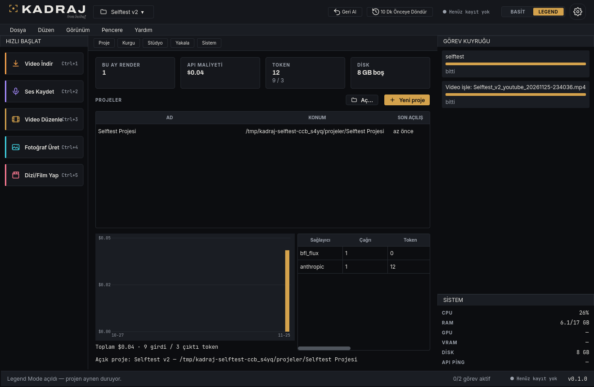

<h1 align="center">KADRAJ</h1>
<p align="center"><sub><i>from İnsibağ</i></sub></p>

<p align="center">Yerel, yapay zekâ destekli video, ses, fotoğraf ve dizi/film stüdyosu. Python ve PySide6 ile yazıldı.</p>

<table>
<tr>
<td align="center" width="50%"><br><sub>Basit Mod</sub></td>
<td align="center" width="50%"><br><sub>Legend Mode</sub></td>
</tr>
</table>

## Özellikler

- **İki mod:** *Basit Mod* sade ve renkli bir arayüz. *Legend Mode* çalışma alanları, iş kuyruğu ve ayrıntılı kontrollerle koyu, profesyonel bir arayüz. Modlar arasında geçerken projen aynen kalır.
- **Windows, Linux ve Android:** Android'de telefonda sade Basit Mod, tablette masaüstündeki gibi iki mod ve tam düzenleyici (aynı APK).
- **Video İndir:** Bağlantıyı yapıştır, videoyu bilgisayarına indir (yt-dlp).
- **Ses Kaydet:** Mikrofondan kayıt. Çıktı her zaman `.wav` (24-bit).
- **Video Düzenle:** Zaman çizelgesi (ekle, böl, geri al), müzik ekleme ve 7 platform şablonuyla FFmpeg dışa aktarma. NVENC veya VAAPI varsa donanım kodlayıcısı kullanılır, yoksa CPU.
- **Fotoğraf Üret:** İstemden görsel üretimi. Bulut sağlayıcılar kendi API anahtarınızla çalışır; yerel Ollama ve ComfyUI de desteklenir.
- **Dizi/Film Yap:** Küçük bir fikirden bölüm bölüm senaryo çıkarır. Her aşama sizin onayınızla ilerler; sonuç `.fountain` ve `.pdf` olarak dışa aktarılır.
- **Ayarlar:** API anahtarları, yerel yapay zekâ algılama, yazı boyutu, dil (varsayılan Türkçe, İngilizce de var).
- **Otomatik kayıt ve geri dönüş:** Değişiklikler 20 saniyede bir kaydedilir (yalnızca değişiklik varsa). "10 Dk Önceye Döndür" projeyi son 10 dakikaya alır; bu işlem geri alınabilir.
- **Legend'de snapshot ağacı:** Projenin anlık görüntülerini alır, dallandırır ve geri yükler.
- **Çevrimdışı öncelikli:** Ses kaydı, düzenleme ve dışa aktarma internet olmadan çalışır. Video indirme ve bulut yapay zekâ sağlayıcıları internet ister.

## İndir ve kur

Hangi dosyayı indireceğinizi aşağıdaki tablodan seçin. Dosyalar için [en son sürüm](https://github.com/UnrealWarlord/kadraj/releases/latest) sayfasına gidin.

| Sistem | İndirilecek dosya |
|---|---|
| Linux (x86_64) | `KADRAJ-<sürüm>-linux-x86_64.tar.gz` (örneğin `KADRAJ-1.0.3-linux-x86_64.tar.gz`; yanındaki `.sha256` ile doğrulayabilirsiniz) |
| Windows 10/11 (64 bit) | `KADRAJ-<sürüm>-windows-x64-setup.exe` (örneğin `KADRAJ-1.0.3-windows-x64-setup.exe`) |
| Android 9+ (telefon ve tablet) | `KADRAJ-<sürüm>-android-arm64.apk` (örneğin `KADRAJ-3.0.0-android-arm64.apk`; yanındaki `.sha256` ile doğrulayabilirsiniz) |
| — | Sürüm sayfasındaki "Source code (zip / tar.gz)" bağlantıları GitHub'ın her sürüme otomatik eklediği ham kaynak koddur; kurulum için gerekmez. `KADRAJ-<sürüm>-android-native-sources.tar` da kurulum için gerekmez: APK'daki FFmpeg ve QuickJS'in kaynak kodudur (lisans gereği). |

### Linux

1. Arşivi açın ve klasöre girin:

   ```bash
   tar -xzf KADRAJ-*-linux-x86_64.tar.gz
   cd KADRAJ-*-linux-x86_64
   ```

2. Kurun:

   ```bash
   ./install.sh
   ```

   Bu komut uygulama menüsüne bir kısayol ekler ve `kadraj` komutunu kurar. `sudo` gerektirmez. Kurmadan doğrudan çalıştırmak için: `./KADRAJ`

Kaldırmak için paket klasöründe `./uninstall.sh` çalıştırın. Verileriniz (`~/.kadraj`) silinmez.

### Windows

1. `KADRAJ-<sürüm>-windows-x64-setup.exe` dosyasına çift tıklayın. Yönetici izni gerekmez; uygulama kullanıcı klasörüne kurulur.
2. Windows "Bilgisayarınız korundu" (SmartScreen) uyarısı verirse "Ek bilgi" → "Yine de çalıştır" seçin. Bu uyarı, dosyanın dijital olarak imzalanmamış olmasından kaynaklanır.
3. KADRAJ'ı Başlat menüsünden açın.
4. Kaldırmak için Ayarlar → Uygulamalar → KADRAJ → Kaldır. Verileriniz (`%USERPROFILE%\.kadraj`) korunur.

### Android (telefon ve tablet)

1. `KADRAJ-<sürüm>-android-arm64.apk` dosyasını telefonda ya da tablette indirin ve açın.
2. Android "bilinmeyen uygulamaları yükleme" izni ister: dosyayı açtığınız uygulama (tarayıcı ya da Dosyalar) için
   izin verin, sonra "Yükle"ye dokunun. Play Protect uyarı verirse "Ayrıntılar" → "Yine de yükle"yi seçin; uygulama
   Play Store'da değildir.
3. KADRAJ'ı uygulamalar listesinden açın. İlk açılışta onay ve kısa bir kurulum sihirbazı gelir; mikrofon izni ilk
   ses kaydında sorulur.

- **Telefonda** yalnız Basit Mod ve onun video düzenleyicisi (sırala, kes, müzik ekle, sihirli dokunuşlar, platform
  şablonuyla dışa aktar) vardır. **Tablette** (ekranın kısa kenarı 600 dp ve üstü) masaüstündeki gibi Basit Mod ve
  Legend Mode, tam düzenleyiciyle.
- Dosyalar uygulamanın Belgeler klasöründedir (`Android/data/org.insibag.kadraj/files/Documents`; telefon bilgisayara
  bağlanınca görünür). "Klasörde göster" yerine "Paylaş" ve "Galeriye kaydet" (Android 11+) vardır.
- Android'de olmayanlar: yerel yapay zekâ (Ollama, ComfyUI), metinle kurgu ve altyazı, ritme göre kes, dikeye çevir,
  arka plan silme, H.265 ve donanım kodlayıcıları. Bulut yapay zekâ servisleri kendi anahtarınızla çalışır.
- **Güncelleme:** yeni APK'yı eskisinin üzerine kurun; projeleriniz ve ayarlarınız kalır. **Kaldırırsanız** Android
  uygulama klasörünü de siler: önce projelerinizi "Paylaş" ile dışarı alın.
- **İmza:** APK'nın imza sertifikası her sürümde aynıdır; Android güncellemeyi yalnız aynı imzayla kabul eder. Kurulum
  "mevcut paketle çakışıyor" derse cihazda başka imzalı bir KADRAJ (örneğin bir deneme sürümü) vardır: onu kaldırın.
  Sertifikayı bilgisayarda denetlemek için: `apksigner verify --print-certs KADRAJ-<sürüm>-android-arm64.apk`.
- **Geliştirici doğrulaması:** Google, mağaza dışından kurulan uygulamalar için geliştirici kimlik doğrulamasını
  2027'de Türkiye dahil bütün ülkelere yayıyor. Geliştiricisi doğrulanmamış bir APK o zaman da kurulabilir, ama
  Android "gelişmiş akış" ister (geliştirici seçenekleri, onay, yeniden başlatma ve bir günlük bekleme) ya da
  bilgisayardan ADB ile kurulur: `adb install KADRAJ-<sürüm>-android-arm64.apk`.

Her sürümün notları [Releases](https://github.com/UnrealWarlord/kadraj/releases) sayfasında ve `docs/release-notes/` içindedir.

## Sistem gereksinimleri

Kurulum paketi her şeyi kendi içinde getirir; **sisteminize ayrıca bir şey kurmanız gerekmez** (FFmpeg, ffprobe, Deno,
yt-dlp, PortAudio ve libxcb-cursor pakete dahildir). Açılışta yt-dlp, FFmpeg ve Deno resmî kaynaklarından denetlenir ve
güncellenir (Ayarlar → Araçlar'dan kapatılabilir; ağ yoksa sessizce atlanır). Lisanslar: `THIRD_PARTY_NOTICES.md`.

### Linux

- İşlemci mimarisi: x86_64
- glibc 2.34 veya üstü (Ubuntu 22.04+, Debian 12+, Fedora 35+, Arch / CachyOS)

Paket Ubuntu 22.04 ve CachyOS üzerinde sınandı.

### Windows

- Windows 10 veya 11, 64 bit

### Android

- Android 9 (API 28) veya üstü, 64 bit ARM (`arm64-v8a`). Telefon ve tabletlerin çoğu böyledir; 32 bit Android
  çalıştıran bazı ucuz cihazlara kurulmaz.
- APK yaklaşık 90 MB; kurulunca yaklaşık 300 MB yer kaplar (projeleriniz ayrıca)
- Android paketi FFmpeg, ffprobe ve QuickJS'i (yt-dlp'nin YouTube için kullandığı JavaScript çalıştırıcısı) içerir;
  bunlar yeni APK ile güncellenir, açılışta yalnız yt-dlp güncellenir.

## Kaynaktan çalıştırma

```bash
python -m venv .venv
.venv/bin/pip install -r requirements.txt
.venv/bin/python main.py                     # uygulamayı aç
.venv/bin/python main.py --selftest          # ekransız sınama
QT_QPA_PLATFORM=offscreen .venv/bin/pytest   # testler
```

Ağır ve isteğe bağlı yapay zekâ paketleri (Whisper, librosa, OpenCV, rembg vb.) için:

```bash
.venv/bin/pip install -r requirements-ai.txt
```

Bu paketler olmadan da uygulama açılır; ilgili özellik "kurulu değil" olarak görünür. Bu paketler henüz gerçek ortamda sınanmadı.

Paketleri derlemek için Docker yeterlidir: `bash packaging/build_linux.sh` (Linux) ve
`bash packaging/build_android.sh` (Android APK'sı; ayrıntılar `docs/steps/MOBILE_7.md`).

Kararlar ve adım raporları: `docs/DECISIONS.md`, `docs/steps/`.

## Gizlilik

- Uygulama çevrimdışı çalışır. Ağa şu durumlarda çıkar: video indirme, bulut yapay zekâ sağlayıcısı ve açılıştaki bileşen güncellemesi (yt-dlp, FFmpeg, Deno; Android'de yalnız yt-dlp; yalnızca resmî GitHub sürümleri, HTTPS, SHA-256 doğrulamalı; Ayarlar → Araçlar'dan kapatılabilir). Bulut sağlayıcı kullanırsanız istem ve içerik o sağlayıcıya gönderilir.
- API anahtarları şifreli bir kasada (`~/.kadraj/vault.bin`; Windows'ta `%USERPROFILE%\.kadraj\vault.bin`) tutulur. Şifreleme anahtarı işletim sisteminin anahtar deposunda (keyring) saklanır; keyring yoksa parolanızdan türetilir. Android'de kasa her zaman parolanızla açılır (Ayarlar → API kasası). Anahtarlar ekranda yalnızca maskeli görünür.
- Uygulamanın kendisi için güncelleme denetimi yalnızca siz "Güncellemeleri denetle" dediğinizde yapılır. Açılışta yalnızca yukarıdaki yardımcı bileşenler (yt-dlp, FFmpeg, Deno) denetlenir; kapatmak için Ayarlar → Araçlar → "Açılışta bileşenleri güncelle".

## Lisans

- Kod: MIT. Ayrıntılar için [LICENSE](LICENSE). Uygulama iskeleti MIT lisanslı SoilClassPro projesinden uyarlanmıştır.
- Yazı tipleri: SIL Open Font License 1.1 (Nunito, Archivo, Inter, JetBrains Mono, Instrument Serif). Lisans metinleri `kadraj/ui/assets/fonts/` içindedir.
