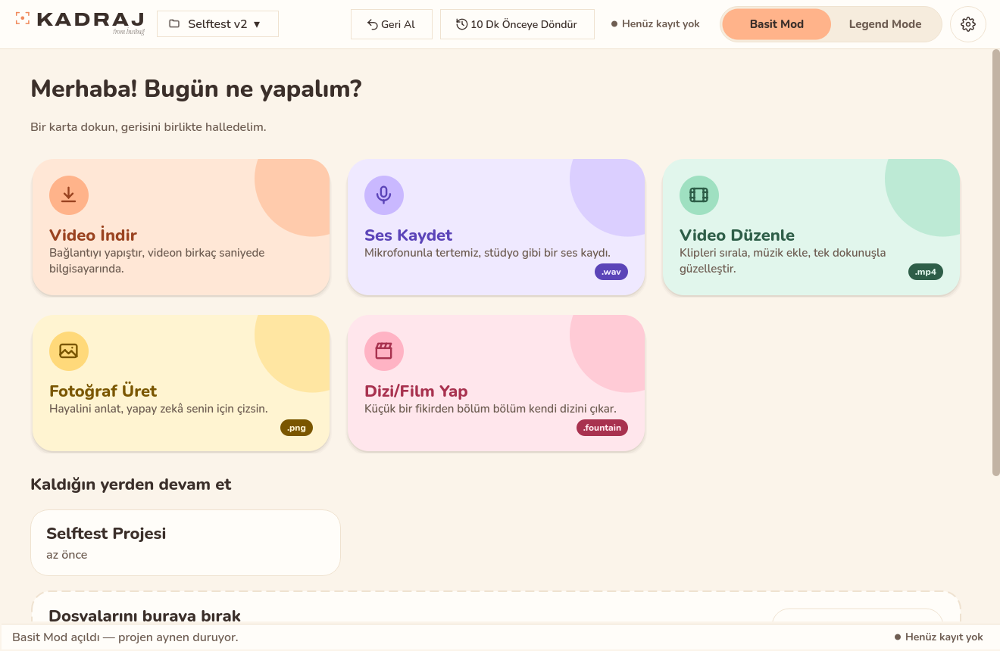

<h1 align="center">KADRAJ</h1>
<p align="center"><sub><i>from İnsibağ</i></sub></p>

<p align="center">Yerel, yapay zekâ destekli video, ses, fotoğraf ve dizi/film stüdyosu. Python ve PySide6 ile yazıldı.</p>

<table>
<tr>
<td align="center" width="50%"><br><sub>Basit Mod</sub></td>
<td align="center" width="50%"><br><sub>Legend Mode</sub></td>
</tr>
</table>

## Özellikler

- **İki mod:** *Basit Mod* sade ve renkli bir arayüz. *Legend Mode* çalışma alanları, iş kuyruğu ve ayrıntılı kontrollerle koyu, profesyonel bir arayüz. Modlar arasında geçerken projen aynen kalır.
- **Video İndir:** Bağlantıyı yapıştır, videoyu bilgisayarına indir (yt-dlp).
- **Ses Kaydet:** Mikrofondan kayıt. Çıktı her zaman `.wav` (24-bit).
- **Video Düzenle:** Zaman çizelgesi (ekle, böl, geri al), müzik ekleme ve 7 platform şablonuyla FFmpeg dışa aktarma. NVENC veya VAAPI varsa donanım kodlayıcısı kullanılır, yoksa CPU.
- **Fotoğraf Üret:** İstemden görsel üretimi. Bulut sağlayıcılar kendi API anahtarınızla çalışır; yerel Ollama ve ComfyUI de desteklenir.
- **Dizi/Film Yap:** Küçük bir fikirden bölüm bölüm senaryo çıkarır. Her aşama sizin onayınızla ilerler; sonuç `.fountain` ve `.pdf` olarak dışa aktarılır.
- **Ayarlar:** API anahtarları, yerel yapay zekâ algılama, yazı boyutu, dil (varsayılan Türkçe, İngilizce de var).
- **Otomatik kayıt ve geri dönüş:** Değişiklikler 20 saniyede bir kaydedilir (yalnızca değişiklik varsa). "10 Dk Önceye Döndür" projeyi son 10 dakikaya alır; bu işlem geri alınabilir.
- **Legend'de snapshot ağacı:** Projenin anlık görüntülerini alır, dallandırır ve geri yükler.
- **Çevrimdışı öncelikli:** Ses kaydı, düzenleme ve dışa aktarma internet olmadan çalışır. Video indirme ve bulut yapay zekâ sağlayıcıları internet ister.

## İndir ve kur

Hangi dosyayı indireceğinizi aşağıdaki tablodan seçin. Dosyalar için [en son sürüm](https://github.com/UnrealWarlord/kadraj/releases/latest) sayfasına gidin.

| Sistem | İndirilecek dosya |
|---|---|
| Linux (x86_64) | `KADRAJ-<sürüm>-linux-x86_64.tar.gz` (örneğin `KADRAJ-1.0.3-linux-x86_64.tar.gz`; yanındaki `.sha256` ile doğrulayabilirsiniz) |
| Windows 10/11 (64 bit) | `KADRAJ-<sürüm>-windows-x64-setup.exe` (örneğin `KADRAJ-1.0.3-windows-x64-setup.exe`) |
| — | Sürüm sayfasındaki "Source code (zip / tar.gz)" bağlantıları GitHub'ın her sürüme otomatik eklediği ham kaynak koddur; kurulum için gerekmez. |

### Linux

1. Arşivi açın ve klasöre girin:

   ```bash
   tar -xzf KADRAJ-*-linux-x86_64.tar.gz
   cd KADRAJ-*-linux-x86_64
   ```

2. Kurun:

   ```bash
   ./install.sh
   ```

   Bu komut uygulama menüsüne bir kısayol ekler ve `kadraj` komutunu kurar. `sudo` gerektirmez. Kurmadan doğrudan çalıştırmak için: `./KADRAJ`

Kaldırmak için paket klasöründe `./uninstall.sh` çalıştırın. Verileriniz (`~/.kadraj`) silinmez.

### Windows

1. `KADRAJ-<sürüm>-windows-x64-setup.exe` dosyasına çift tıklayın. Yönetici izni gerekmez; uygulama kullanıcı klasörüne kurulur.
2. Windows "Bilgisayarınız korundu" (SmartScreen) uyarısı verirse "Ek bilgi" → "Yine de çalıştır" seçin. Bu uyarı, dosyanın dijital olarak imzalanmamış olmasından kaynaklanır.
3. KADRAJ'ı Başlat menüsünden açın.
4. Kaldırmak için Ayarlar → Uygulamalar → KADRAJ → Kaldır. Verileriniz (`%USERPROFILE%\.kadraj`) korunur.

Render ve dışa aktarma için FFmpeg gerekir. PowerShell'de:

```powershell
winget install Gyan.FFmpeg
```

Her sürümün notları [Releases](https://github.com/UnrealWarlord/kadraj/releases) sayfasında ve `docs/release-notes/` içindedir.

## Sistem gereksinimleri

Kurulum paketi her şeyi kendi içinde getirir; **sisteminize ayrıca bir şey kurmanız gerekmez** (FFmpeg, ffprobe, Deno,
yt-dlp, PortAudio ve libxcb-cursor pakete dahildir). Açılışta yt-dlp, FFmpeg ve Deno resmî kaynaklarından denetlenir ve
güncellenir (Ayarlar → Araçlar'dan kapatılabilir; ağ yoksa sessizce atlanır). Lisanslar: `THIRD_PARTY_NOTICES.md`.

### Linux

- İşlemci mimarisi: x86_64
- glibc 2.34 veya üstü (Ubuntu 22.04+, Debian 12+, Fedora 35+, Arch / CachyOS)

Paket Ubuntu 22.04 ve CachyOS üzerinde sınandı.

### Windows

- Windows 10 veya 11, 64 bit

## Kaynaktan çalıştırma

```bash
python -m venv .venv
.venv/bin/pip install -r requirements.txt
.venv/bin/python main.py                     # uygulamayı aç
.venv/bin/python main.py --selftest          # ekransız sınama
QT_QPA_PLATFORM=offscreen .venv/bin/pytest   # testler
```

Ağır ve isteğe bağlı yapay zekâ paketleri (Whisper, librosa, OpenCV, rembg vb.) için:

```bash
.venv/bin/pip install -r requirements-ai.txt
```

Bu paketler olmadan da uygulama açılır; ilgili özellik "kurulu değil" olarak görünür. Bu paketler henüz gerçek ortamda sınanmadı.

Kararlar ve adım raporları: `docs/DECISIONS.md`, `docs/steps/`.

## Gizlilik

- Uygulama çevrimdışı çalışır. Ağa şu durumlarda çıkar: video indirme, bulut yapay zekâ sağlayıcısı ve açılıştaki bileşen güncellemesi (yt-dlp, FFmpeg, Deno; yalnızca resmî GitHub sürümleri, HTTPS, SHA-256 doğrulamalı; Ayarlar → Araçlar'dan kapatılabilir). Bulut sağlayıcı kullanırsanız istem ve içerik o sağlayıcıya gönderilir.
- API anahtarları şifreli bir kasada (`~/.kadraj/vault.bin`; Windows'ta `%USERPROFILE%\.kadraj\vault.bin`) tutulur. Şifreleme anahtarı işletim sisteminin anahtar deposunda (keyring) saklanır; keyring yoksa parolanızdan türetilir. Anahtarlar ekranda yalnızca maskeli görünür.
- Uygulamanın kendisi için güncelleme denetimi yalnızca siz "Güncellemeleri denetle" dediğinizde yapılır. Açılışta yalnızca yukarıdaki yardımcı bileşenler (yt-dlp, FFmpeg, Deno) denetlenir; kapatmak için Ayarlar → Araçlar → "Açılışta bileşenleri güncelle".

## Lisans

- Kod: MIT. Ayrıntılar için [LICENSE](LICENSE). Uygulama iskeleti MIT lisanslı SoilClassPro projesinden uyarlanmıştır.
- Yazı tipleri: SIL Open Font License 1.1 (Nunito, Archivo, Inter, JetBrains Mono, Instrument Serif). Lisans metinleri `kadraj/ui/assets/fonts/` içindedir.
