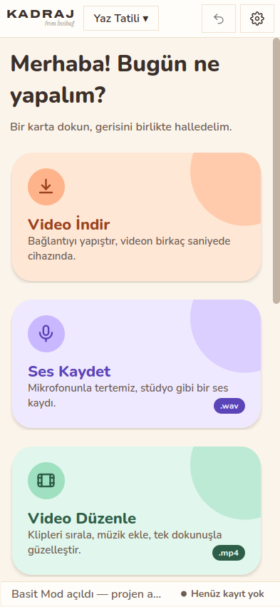
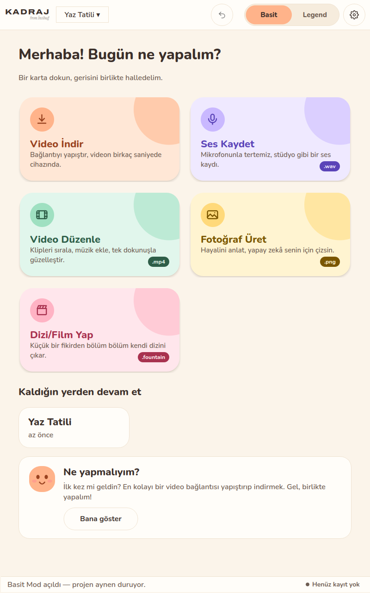
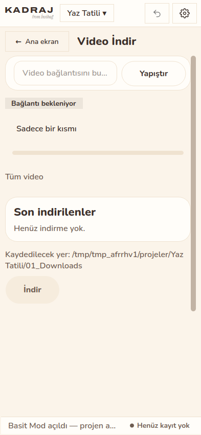
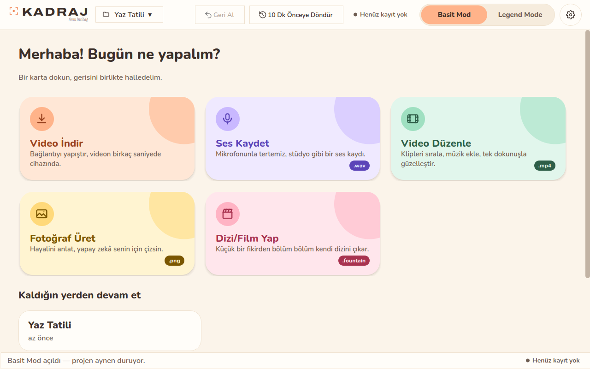
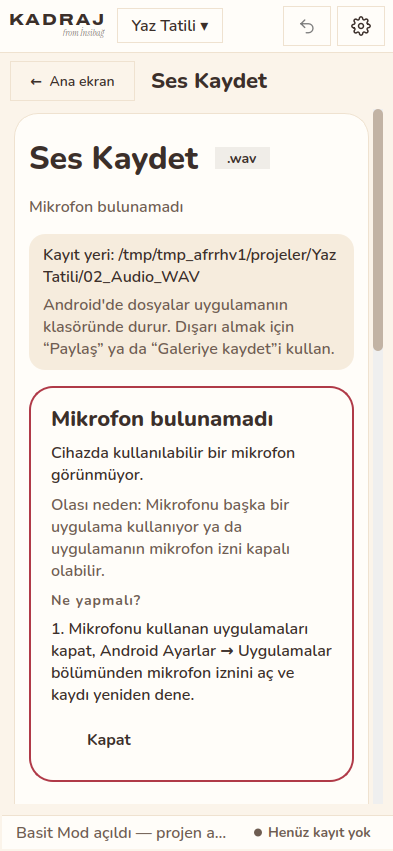
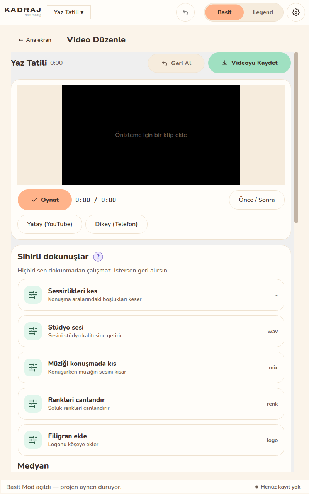
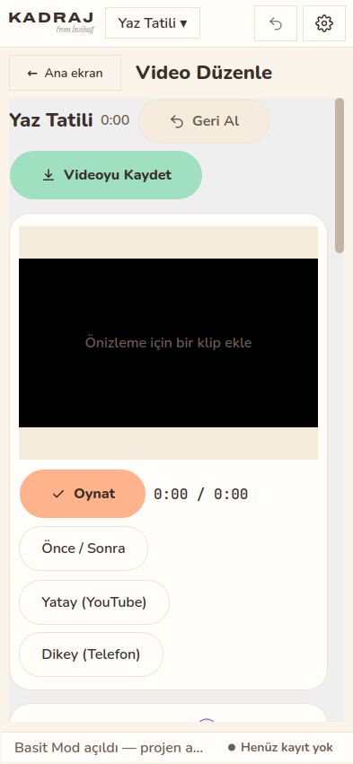
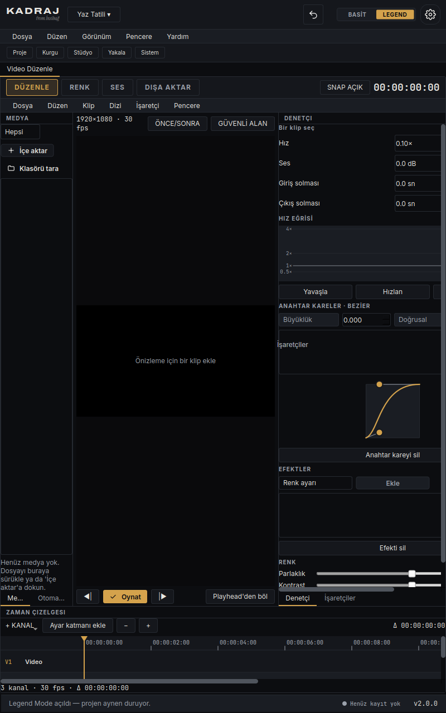
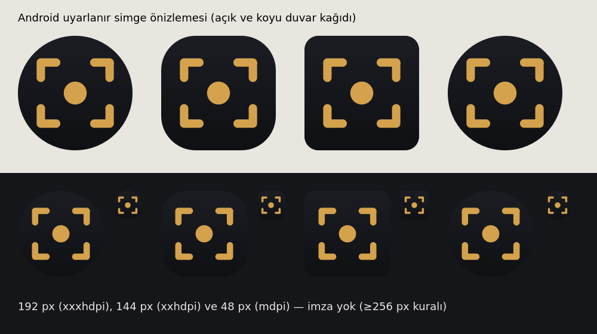
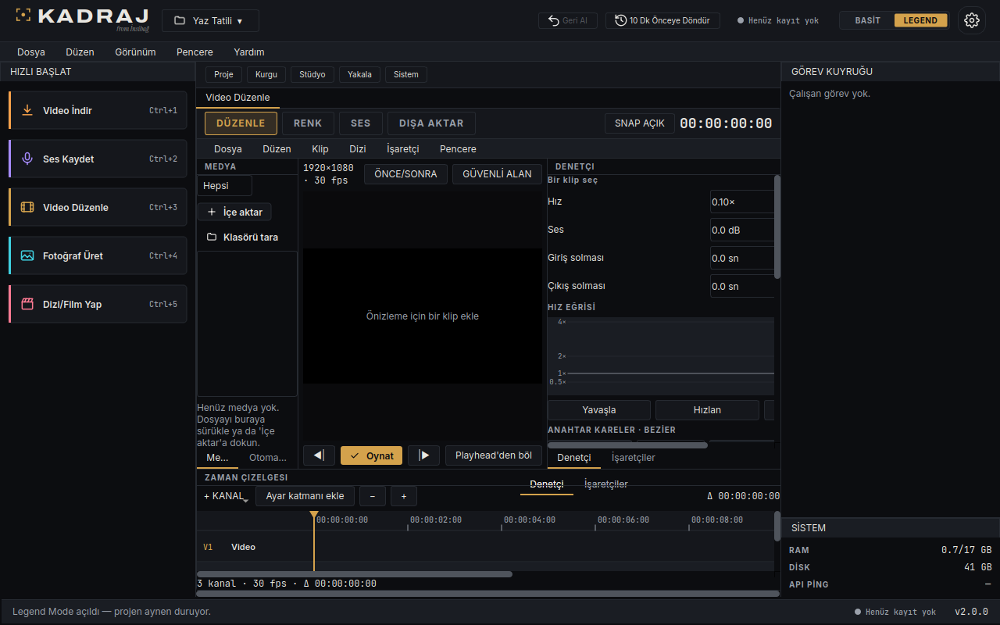

# Mobil 6. adım · Telefon ve tablet düzeni, dokunmatik, Paylaş / Galeriye kaydet, Android simgesi

Tarih: 2026-11-26/27 · Dal: `mobile` · Ortam: Claude'un bulut makinesinde Docker (`kadraj-test`, APK için
`kadraj-android-build`; M8). KVM yok: emülatör çalışmaz, cihaz denemesi Erol'da. Telefon ve tablet görünümü
masaüstünde `KADRAJ_FORM_FACTOR=phone|tablet` ve `KADRAJ_PLATFORM=android` ile taklit edildi (ekransız Qt).

## Sonuç

### 6a · Telefon mu, tablet mi (M1, M2)

- `kadraj/device.py`: en küçük kenarı 600 dp ve üstü olan cihaz **tablet**, altı **telefon** (Android'in `sw600dp`
  eşiği); `is_mobile()` ikisini birden kapsar. Aynı APK ekrana göre seçer.
- **Telefon:** yalnız Basit Mod (`legend_allowed()` → `False`). Mod anahtarı gizli, `Ctrl+M` kapalı, ayarlarda
  Legend kayıtlıysa Basit açılır. Video düzenleme Basit Mod'un düzenleyicisidir (sırala, kes, müzik, sihirli
  dokunuşlar, platform şablonuyla dışa aktarma).
- **Tablet:** masaüstündeki gibi Basit + Legend Mode ve tam düzenleyici.

### 6b · Her sayfa ekrana sığar (M24)

- `kadraj/ui/adaptive.py` ve `kadraj/ui/widgets/flow.py` (`FlowLayout`): telefon ve tablette yatay satırlar sığmazsa
  alt satıra geçer (sığarsa masaüstündeki tek satır aynen); sayfa yığınları ve sekmeler boyu yalnız görünen sayfadan
  alır; uzun yollar kırılabilir; pencereler (ilk açılış sihirbazı dahil) ekran boyunda açılır.
- **Telefon üst çubuğu 360 px'e sığar:** mod anahtarı yok, düğmeler yalnız ikon, proje adı sığmazsa "…" ile kısalır
  (tam ad ipucunda), "10 Dk Önceye Döndür" proje menüsünde, kayıt göstergesi alttaki şeritte.
- **Tablet dikey:** Legend panelleri (Hızlı Başlat, Görev Kuyruğu, Sistem) gizlenir, orta alan ekranın tamamını alır;
  yan çevrilince geri gelir. Üst çubuk daralır (küçük logo, kısa mod adları "Basit / Legend", Döndür proje
  menüsünde) ve 600 px'e (7" tablet) sığar. Legend sayfası ekrandan genişse yana kayar; yüksekliği masaüstündeki gibi
  ekrana sıkışır (zaman çizelgesi ekranda kalır).
- **Ana ekran:** dosya bırakma alanı dokunmatik cihazda gizli; telefonda kartlar tek sütun ve tam genişlik, "Kaldığın
  yerden devam et" kartları alt alta.
- Sahne panosunun sütunları telefonda yana kayar; alt şerit iletisi sığmazsa "…" ile kısalır.

### 6c · Dokunmatik (M25)

- Bütün kaydırma alanları parmakla kayar (Qt Widgets bunu Android'de kendiliğinden yapmaz; `QScroller`). Kısa dokunma
  tıklamadır, parmak kayarsa sayfa kayar. Açılır listeler ve `NO_FLICK` verilen alanlar hariç.
- Sürüklenerek kullanılan çizim alanlarında (zaman çizelgesi, aralık çubuğu, önce/sonra sürgüsü, maske fırçası,
  eğriler) dokunma doğrudan o alana gider; sayfa kaymaz.
- Dizi/Film panosunda kartlar sürüklenmez; seçili kart "Taşı" listesinden başka sütuna geçer.
- **Geri tuşu:** açık sayfadan ana ekrana döner; ana ekranda 2,5 sn içinde ikinci basış uygulamadan çıkar ("Çıkmak
  için bir kez daha geri bas."). python-for-android'in her tuşun ilk basışını yutan "Click again to close the app"
  kısayolu kaldırıldı (`packaging/android/p4a_hook.py`).

### 6d · Dosyalar: Aç, Paylaş, Galeriye kaydet, dosya seçme (M20)

- PySide6'nın Android yapısında JNI bağı (`QJniObject`) yok. APK'ya iki Java sınıfı eklendi
  (`packaging/android/java`): **`KadrajFiles`** (dosya sağlayıcı; dışa kapalı, yalnız okunur, dosya başına geçici
  izin; `.kadraj` gibi gizli klasörler hiç açılmaz) ve **`Bridge`** (Python'un uygulama klasörüne yazdığı komut
  dosyalarını `FileObserver` ile izler: `open`, `share`, `screen`, `scan`). Python tarafı `kadraj/bridge.py`.
- `kadraj/ui/files.py`: masaüstünde "Aç" ve "Klasörde göster" aynen; Android'de "Klasörde göster" yerine **"Paylaş"**
  (sistemin paylaşım menüsü) ve **"Galeriye kaydet"**, "Aç" uygun uygulamayı açar. İndirme, kayıt, düzenleyici dışa
  aktarma, fotoğraf ve dizi çıktılarında.
- `kadraj/storage/gallery.py`: "Galeriye kaydet" türüne göre `Movies/`, `Music/`, `Pictures/` ya da `Download/`
  altındaki uygulama klasörüne bir kopya yazar (Android 11+ izinsiz); aynı ad varsa `(2)`, `(3)`… eklenir.
- **Dosya seçme:** Android'in seçicisi `content://` döner; Python ve FFmpeg bunu açamaz. Seçilen dosya uygulama
  klasörüne (`Belgeler/Imports`) kopyalanır; aynı ad ve boyuttaki dosya yeniden kopyalanmaz.
- **Ekran açık kalsın:** kayıt ya da iş kuyruğunda iş sürerken ekran kararmaz (köprünün `screen` komutu).
- Android'de proje aç: klasör seçici yerine uygulama alanındaki projelerin listesi.

### 6e · Android'de olmayanlar gizli, metinler, simge (M21–M23)

- **Gizlenenler (M21):** düzenleyicide dinamik altyazı ve metinle kurgu (faster-whisper), ritme göre kes (librosa),
  dikeye çevir (OpenCV), yapay zekâ ile arka plan silme (rembg); Pro dışa aktarmada H.265 (x265 Android FFmpeg'inde yok),
  NVENC ve VA-API. Sistem panelinde yalnız RAM, disk ve API ping (psutil yok; RAM `/proc/meminfo`'dan). Açılış
  ekranında yerel yapay zekâ adımı yok. FFmpeg hata kartında "Bileşenleri güncelle" yok (FFmpeg uygulamayla gelir).
- **Metinler (M23):** Android'de "bilgisayar" diyen 26 metnin "cihaz" diyen eşi (`ANDROID_STRINGS`, TR + EN). Yeni
  yer tutucu yok; masaüstü metinleri değişmedi.
- **Simge (M22):** Android uyarlanır simgesi (vektör ön plan, degrade zemin, Android 13 temalı simge için tek renk
  katman), `kadraj.svg`'den `tools/make_icons.py` ile üretilir (`packaging/android/res`). Vizör işareti her maskede
  (daire, damla, yuvarlak kare) güvenli alanın içinde. Başlatıcı simgesi ≤192 px olduğundan **imza yok** (≥256 px
  kuralı). APK derlemesi simgeyi ve manifest'teki sağlayıcıyı `aapt2` ile denetler.

### 6f · Doğrulama ve ekran görüntüsünde bulunan düzeltmeler

- Telefonda ana kartlar ekranın yarısında kalıyordu (geniş düzenden kalan boş sütunun esneme payı) → tam genişlik.
- Dar kartta açıklama `.wav` / `.mp4` rozetinin altına giriyordu → açıklama rozete gelirse daralır.
- Alt şerit iletisi yarım kelimede kesiliyordu → "…" ile kısalır, tam metin ipucunda.
- Tablet dikeyde Basit Mod üst çubuğu taşıyordu (ayarlar düğmesi mod anahtarının üstüne biniyordu) → dar çubuk.
- Tablet Legend düzenleyicisinde zaman çizelgesi ekranın altına itiliyordu (Qt, kaydırma alanında gizli sayfaların
  da tercih edilen yüksekliğini en küçük boy sayıyordu) → yalnız görünen sayfanın en küçük yüksekliği.

## Ekran görüntüleri (`docs/steps/mobile6/`)

| Telefon (393 × 851) | Tablet |
|---|---|
|  ana ekran |  ana ekran, dikey (800 × 1280) |
|  Video İndir |  ana ekran, yatay (1280 × 800) |
|  Ses Kaydet (kapta mikrofon yok) |  Basit düzenleyici, dikey |
|  Video Düzenle |  Legend düzenleyici, dikey |
|  başlatıcı simgesi, maskelerle |  Legend düzenleyici, yatay |

## Plandan farklar

- Plan "Galeriye kaydet" için MediaStore / SAF diyordu: Android 11+ uygulamanın ortak klasörlere izinsiz yazmasına
  izin verdiği için doğrudan kopya + galeriye tanıtma (`scan`) seçildi; Android 9–10'da "Paylaş" önerilir.
- Plan uzun işler için ön plan servisi bildirimi ya da "ekran açık kalsın" diyordu: şimdilik "ekran açık kalsın"
  (ön plan servisi Java tarafında ayrı iş; izin ve bildirim metni gerektirir).
- Plan sistem panelinde "pil/depolama" diyordu: pil yok (Python'dan okunamıyor), RAM + disk + ping gösteriliyor.
- iOS bu projeden çıkarıldı (Erol, 2026-11-26: "ios u boşver"; M5 güncellendi).

## Bilinen sınırlar

- **Java köprüsü ve dosya sağlayıcı cihazda denenmedi** (emülatör yok): "Aç", "Paylaş", "Galeriye kaydet", ekranın
  açık kalması ve geri tuşu ilk cihaz denemesinde bakılacak ilk şeyler. Köprü yanıt vermezse sayfada sade bir not
  çıkar, uygulama donmaz.
- Köprü Android'in `FileObserver` olaylarına dayanır; olay gecikirse yanıt da gecikir.
- "Galeriye kaydet" yalnız Android 11 ve sonrasında; Android 9–10'da "Paylaş" kullanılır.
- Seçilen dosyaların kopyaları (`Belgeler/Imports`) kendiliğinden silinmez.
- Tablet dikeyde Legend sayfaları ekrandan genişse yana kaydırılır (düzenleyicinin Denetçi sütunu, Stüdyo).
  Yatayda Legend panelleri ortadaki alanı daraltır; Pencere menüsünden kapatılabilir.
- Masaüstünden kalan görsel kusur (v2.0.0'da da var): Legend düzenleyicisinde sekmeli panellerin ("Denetçi |
  İşaretçiler") eski bir sekme çubuğu ikinci kez görünüyor.
- APK'da Kivy'nin açılış resmi (`presplash.jpg`) hâlâ paketleniyor ama kullanılmıyor.

## Doğrulama

- Yeni testler: `tests/core/test_mobile_layout.py` (telefon/tablet düzeni, üst çubuk, sığma denetimi, FlowLayout,
  dokunmatik, Legend zaman çizelgesi), `tests/core/test_mobile_files.py` (köprü, dosya eylemleri, galeri, içe
  aktarma, geri tuşu, ekran açık kalsın), `tests/core/test_mobile_android.py` (gizlenen özellikler, "cihaz"
  metinleri, simge).
- Tam takım (Docker, ağ kapalı): 1285 geçti, 4 atlandı (canlı ses testleri; ses aygıtı yok). `--selftest`: TAMAM.
- APK: `KADRAJ-2.0.0-android-arm64-debug.apk` (deneme; hata ayıklama imzalı) **90 MB**, sha256
  `a3fe27998dd7acbc68ea3d96f6057c0d32e9d496136057e889ab442d641e9634`. Derleme betiğinin denetimleri geçti
  (`KadrajFiles` ve `Bridge` sınıfları dex'te, sağlayıcı manifest'te, uyarlanır simge pakette); kanca
  `PythonActivity.onKeyDown`'u kaldırdı. `aapt2`: izinler `INTERNET` + `RECORD_AUDIO`, `extractNativeLibs=true`,
  sağlayıcı `org.insibag.kadraj.files`, simge `mipmap-anydpi-v26/icon.xml`, yalnız `arm64-v8a`;
  `zipalign -c -P 16` (16 KB sayfa hizası) geçti. Uygulama dosyalarında `bridge.py`, `storage/gallery.py`,
  `ui/adaptive.py`, `ui/files.py`, `ui/widgets/flow.py` var.

## Kararlar

- Karar: (M20) Android dosya eylemleri Java köprüsüyle (dosya sağlayıcı + `FileObserver` komut klasörü, `QJniObject`
  yok): "Klasörde göster" yerine "Paylaş" ve "Galeriye kaydet", "Aç" uygun uygulamayı açar; seçilen `content://`
  dosyaları uygulama klasörüne kopyalanır; kayıt ve işler sürerken ekran açık kalır; geri tuşunu uygulama karşılar.
- Karar: (M21) Android'de çalışmayan özellikler gösterilmez (devre dışı düğme yerine yok): altyazı, metinle kurgu,
  ritme göre kes, dikeye çevir, arka plan silme, H.265, donanım kodlayıcıları, işlemci/ekran kartı ölçümü, yerel AI.
- Karar: (M22) Android başlatıcı simgesi uyarlanır (vektör) ve imzasız; ana SVG'den üretilir, elle düzenlenmez.
- Karar: (M23) Android metinleri ayrı tabloda (`ANDROID_STRINGS`), yalnız "bilgisayar" diyen metinler; masaüstü
  metinlerine dokunulmaz.
- Karar: (M24) Telefonda her Basit sayfa 360 px'e sığar, tablette üst çubuk 600 px'e; sığmayan satırlar alt satıra
  geçer. Tablet dikeyde Legend panelleri gizlenir, sayfa ekrandan genişse yana kayar.
- Karar: (M25) Dokunmatik: bütün kaydırma alanları parmakla kayar, çizim alanları dokunmayı doğrudan alır,
  sürükle-bırak yerine "Taşı" listesi.

## DEVİR

7. adım (CI: `release.yml`'e Android işi) için:

- APK derlemesi `packaging/android/build_apk.sh` (debug ya da release); Java kaynakları, uyarlanır simge ve p4a kancası
  betiğin içinden eklenir, ayrıca bir şey gerekmez. Betik sonunda sağlayıcı, köprü sınıfları ve simge denetlenir.
- Yerel araçlar (`build_native.sh`, ~13 dk) CI'da önbelleğe alınabilir; kaynak arşivi Release'e eklenecek (M14).
- İmza: `KADRAJ_KEYSTORE_B64`, `KADRAJ_KEYSTORE_PASSWORD`, `KADRAJ_KEY_ALIAS`, `KADRAJ_KEY_PASSWORD` (depo
  gizlileri; anahtarı Erol üretir ve GitHub'a kendisi ekler, Claude görmez).
